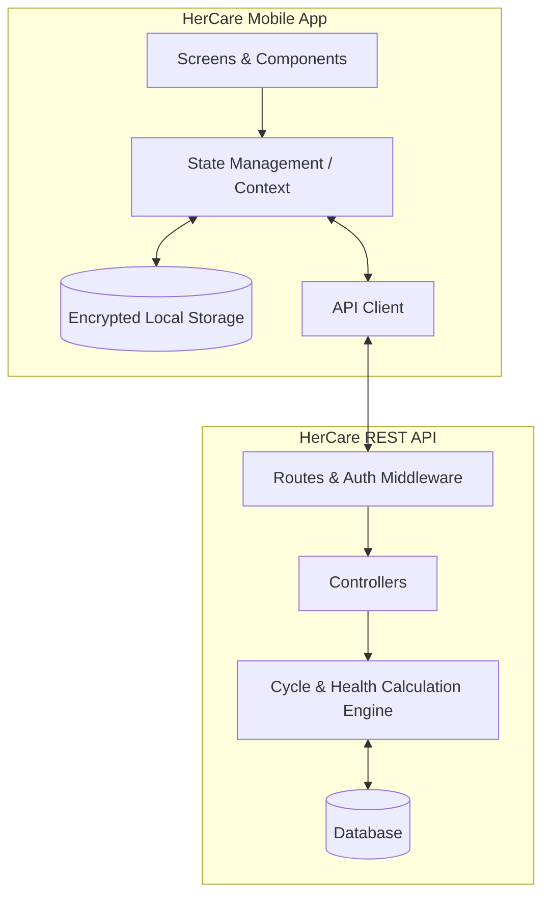

# System Architecture & Flow

## Architecture Diagram

## Data Privacy
- Personal health data and cycle records are strictly tied to authenticated user credentials.
- Option for offline-first mode with local SQLite / SecureStore fallback.
